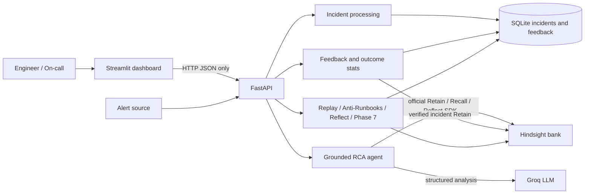

# IncidentMind AI

IncidentMind AI is an incident-response assistant that recommends (but never
executes) recovery actions. Its persistent learning layer will use official
[Hindsight](https://github.com/vectorize-io/hindsight) memory banks to retain
incident outcomes, recall relevant evidence, and reflect on recurring patterns.

## Current status

**Phase 8 complete:** the FastAPI baseline, official Hindsight memory wrapper,
incident ingestion and grounded analysis, engineer feedback, Replay Lab,
Anti-Runbooks, cached Reflect Insights, and Streamlit dashboard are available.
Default-off Chaos Dojo, memory staleness detection, and deploy-risk evidence
lookup are also available. Synthetic and real feedback counts are displayed
separately. Edge-case and sequential load checks, Docker Compose, and the
record-ready demo script are included.

## 10-line implementation plan

1. Establish a tested FastAPI/configuration baseline and record public contracts.
2. Add a thin, typed official Hindsight client wrapper and a test-only fake.
3. Parse alerts/logs into normalized, persisted incident records.
4. Recall Hindsight evidence and produce validated, grounded RCA recommendations.
5. Capture engineer verification and retain real outcomes for future learning.
6. Add Replay Lab to compare recommendations with and without memory.
7. Surface failed fixes through anti-runbook warnings and use Hindsight Reflect insights.
8. Build a Streamlit UI that calls only the FastAPI backend.
9. Add opt-in synthetic chaos, staleness/conflict, and deploy-risk features.
10. Harden, document, containerize, test from a fresh clone, and tag `v1.0`.

## Architecture



The dashboard calls only FastAPI. SQLite stores application incidents,
engineer feedback, and the Reflect cache. Hindsight is the only memory layer.
Groq produces structured analysis; deterministic runbooks remain the fallback.

## How Hindsight is used

Before implementation, the official documentation and repository source were
inspected, including the Python client implementation and its operation tests.
The verified Python package is
`hindsight-client`; its client class is `hindsight_client.Hindsight`. The
repository’s implementation is in
`hindsight-clients/python/hindsight_client/hindsight_client.py`, with behavioral
tests in `hindsight-clients/python/tests/`, notably `test_main_operations.py`,
`test_async_sync_parity.py`, and the Retain/Recall/Reflect option tests.

Phase 1 installs that official package and adapts its documented `Hindsight`
client. The current client source exposes `create_bank`, `retain`, `recall`,
and `reflect` as synchronous convenience methods; the application runs these
calls in worker threads so FastAPI's event loop remains responsive. The wrapper
adapts official response models to IncidentMind typed evidence results; it does
not implement vector search, fact extraction, graph retrieval, or reflection.
Hindsight remains the only memory layer.

The application calls the official SDK through
[hindsight_client.py](hindsight_memory/hindsight_client.py): `create_bank`
initializes or retrieves the configured bank, `retain` stores an incident,
`recall` retrieves relevant evidence, and `reflect` answers history questions.
The payload adapter is in [memory_retain.py](hindsight_memory/memory_retain.py),
and Recall and Reflect responses are adapted in
[memory_recall.py](hindsight_memory/memory_recall.py) and
[memory_reflect.py](hindsight_memory/memory_reflect.py). Synchronous SDK calls
run in worker threads behind bounded timeouts and retries. Groq HTTP 429 rate
limits are retried with backoff; exhausted retries use the deterministic
runbook fallback.

`HINDSIGHT_BANK_ID` selects the memory bank and defaults to `incidentmind`.
Use a new ID such as `incidentmind-demo` for a clean recording bank without
deleting existing data. Replay Lab creates an isolated bank per run.

## Hindsight assumptions to verify in Phase 1

- The installed `hindsight-client` version matches the documented client API.
- Cloud authentication accepts `api_key` as the documented bearer token.
- The configured Hindsight endpoint supports bank creation and the configured bank ID.
- `create_bank` is idempotent enough for create-or-retrieve behavior, or the
  official bank-list/get API must be used first.
- Retain response, Recall `results`, and Reflect response/citation fields match
  the installed SDK models used by our typed adapter.
- Service-side timeout/retry semantics do not conflict with the wrapper’s
  bounded retries and fallback behavior.

## Setup and Phase 0 demo

```powershell
python -m venv .venv
.\.venv\Scripts\Activate.ps1
pip install -r requirements.txt
Copy-Item .env.example .env
# Fill in the required values before using Hindsight or Groq features.
uvicorn main:app --reload
```

Visit `http://127.0.0.1:8000/health`. Phase 0’s endpoint works even before
credentials are populated. Run tests with:

```powershell
pytest
```

The integration tests are marked separately and skip if credentials are
missing:

```powershell
pytest -m integration -q
```

### Docker Compose

After copying and configuring `.env`, start the API and dashboard:

```powershell
docker compose up --build
```

Open `http://localhost:8501` for the dashboard and `http://localhost:8000/docs`
for the API. SQLite data persists in the `incidentmind-data` volume. For
self-hosted Hindsight running on the host machine, set `HINDSIGHT_BASE_URL` to
an address reachable from the containers, such as
`http://host.docker.internal:8888`; `localhost` inside a container refers to
that container. `docker compose down` stops the services and keeps the volume.
Use `docker compose down -v` only when you intentionally want to remove local
incident data.

## Phase 1 memory demo

With a Hindsight service reachable at `HINDSIGHT_BASE_URL` and its API key in
`.env`, run `python -m hindsight_memory.demo` to retain an incident and recall
similar evidence. To load the bundled, explicitly synthetic sample incidents,
run `python -m hindsight_memory.seed`. Unit tests use `FakeMemory`; production
code always constructs `HindsightMemory` with the official SDK.

For the full record-ready eight-step story, see [DEMO_SCRIPT.md](DEMO_SCRIPT.md).

## Phase 2 incident ingestion

Start the API with `uvicorn main:app --reload`, then post an alert:

```powershell
Invoke-RestMethod -Method Post -Uri http://127.0.0.1:8000/incidents `
  -ContentType 'application/json' `
  -Body '{"service":"payments-api","error":"database connection pool exhausted","cpu_percent":91,"failed_requests":24,"status":"degraded","logs":"sqlalchemy.exc.TimeoutError: pool exhausted"}'
```

The response includes a generated incident ID, category, severity, normalized
log signature, and extracted evidence. Fetch the stored record with
`GET /incidents/{incident_id}`. SQLite uses
`sqlite:///./data/incidents.sqlite3` by default; set `DATABASE_URL` to override.

## Phase 3 analysis demo

Configure `HINDSIGHT_API_KEY`, `HINDSIGHT_BASE_URL`, `GROQ_API_KEY`, and
`MODEL_NAME` in `.env`, then start the API and submit an alert followed by an
analysis request:

```powershell
$incident = Invoke-RestMethod -Method Post -Uri http://127.0.0.1:8000/incidents `
  -ContentType 'application/json' `
  -Body '{"service":"payments-api","error":"database connection pool timeout","status":"degraded","logs":"Timeout waiting for a connection from the pool"}'
Invoke-RestMethod -Method Post -Uri "http://127.0.0.1:8000/incidents/$($incident.id)/analyze"
```

The analysis response shows retrieved memory text, suspected hypotheses,
runbook recommendations, and whether cold-start or fallback behavior applied.
Every recommendation is for engineer review; IncidentMind does not execute it.

## Phase 4 feedback and approval

Submit engineer verification with `POST /incidents/{incident_id}/feedback`.
Feedback is stored idempotently, and verified incident details are retained in
Hindsight when the service is available. `GET /stats/outcomes` reports recorded
counts such as `2 of 3 recorded`; it does not calculate unsupported rates.

Any action simulation requires a matching engineer approval first:

```powershell
Invoke-RestMethod -Method Post -Uri "http://127.0.0.1:8000/incidents/$($incident.id)/approve-action" `
  -ContentType 'application/json' `
  -Body '{"action_id":"restart-workers","action":"Restart the affected workers","approved_by":"engineer@example.test"}'
Invoke-RestMethod -Method Post -Uri "http://127.0.0.1:8000/incidents/$($incident.id)/execute-action" `
  -ContentType 'application/json' `
  -Body '{"action_id":"restart-workers"}'
```

The second route only records a simulation; it never runs a recovery action.

## Phase 5 memory innovation

`POST /innovation/replay` compares recommendations for the same ordered stored
incidents with memory disabled and enabled. Each run uses an isolated Hindsight
bank; response metrics include cited prior incidents and steps to a verified
fix only when a stored engineer resolution can be measured. Truth fields are
masked from the current incident during analysis.

Pass `innovation_enabled=true` to
`POST /incidents/{incident_id}/analyze` to include Anti-Runbook warnings based
on failed engineer-reported fixes. Warnings include recorded failed/attempted
counts and incident context. The flag is off by default.

`POST /innovation/insights` accepts `{"question":"Which fixes failed?"}` and
returns a Hindsight Reflect result cached in SQLite for five minutes. If
Hindsight Reflect is unavailable, it returns a clearly labeled fallback
computed only from persisted engineer feedback. Set `refresh: true` to bypass
the cache. Run `pytest` for the complete compatibility suite.

## Phase 6 dashboard

Start the FastAPI backend and Streamlit dashboard in separate terminals:

```powershell
.\.venv\Scripts\python.exe -m uvicorn main:app --reload
.\.venv\Scripts\python.exe -m streamlit run frontend/dashboard.py
```

Set `INCIDENTMIND_API_URL` if the API is not at `http://127.0.0.1:8000`.
The dashboard shows the incident feed and detail, suspected causes, Hindsight
evidence, recommendations, Anti-Runbook warnings, engineer feedback, Replay Lab
comparison/chart, and feedback/confirmed-retain counts. Its API client talks
only to FastAPI. See [tests/phase6/MANUAL.md](tests/phase6/MANUAL.md) for the
demo screenshot checklist and empty/error-state checks.

## Phase 7 stretch features

Experimental features are disabled by default. Set only the flags you want to
enable in `.env`:

```dotenv
CHAOS_DOJO_ENABLED=true
STALENESS_ENABLED=true
DEPLOY_RISK_ENABLED=true
```

Chaos Dojo generates a tagged synthetic scenario, analyzes it, and retains a
scripted resolution through Hindsight. Synthetic examples appear separately in
the dashboard and are excluded from verified outcome statistics. Check for
contradictory verified memories with
`GET /incidents/{incident_id}/staleness`. Submit a change description to
`POST /innovation/deploy-risk` to retrieve related historical evidence; the
response provides evidence for review and does not assign a risk score or make
a deployment decision. `GET /stats/memory/origins` separates real and
synthetic retain counts without changing the Phase 6 memory-stats contract.
Review the `CHAOS_DOJO_ENABLED`, `STALENESS_ENABLED`,
and `DEPLOY_RISK_ENABLED` flags before exposing these experimental endpoints.

## Phase 8 edge cases and load check

Incident logs accept up to 200,000 characters and the persisted evidence excerpt
is capped at 50,000 characters. Unicode is preserved. Exercise the 50 sequential
incident flow and run the complete suite with:

```powershell
pytest tests/phase8 -q
pytest -q
```

## BAND Desktop (hackathon collaboration requirement)

Band Desktop (formerly Jam) is installed separately from this Python app. The
official Windows x64 installer is linked in Band’s
[installation guide](https://docs.band.ai/band-desktop/install). Run it, sign
in to a Band account, enable the locally installed Codex runtime in the setup
wizard, then verify with `band daemon status` and `band doctor`. It is used for
agent collaboration and auditable development workflow; it is **not** part of
IncidentMind’s runtime, memory system, or production data path.

## Safety and limitations

- Recommendations require explicit engineer approval before any simulated or
  logged action in later phases; IncidentMind never executes recovery actions.
- Secrets belong only in environment variables. `.env` is ignored by Git.
- Hindsight and Groq credentials are not configured in this workspace, so live
  cloud integration tests are skipped here. The official SDK adapters have
  unit and contract coverage; run `pytest -m integration -q` when services and
  credentials are available.
- Rate-limit retries are bounded. If a provider continues returning 429,
  IncidentMind uses its deterministic fallback rather than claiming an
  unverified analysis.

